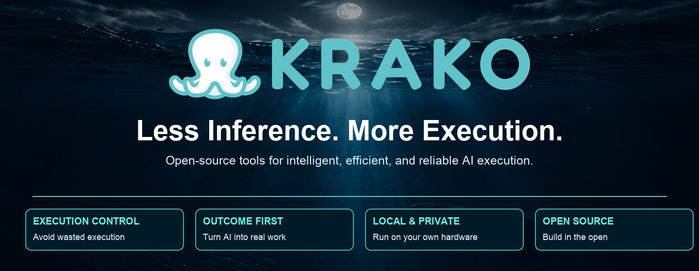

<div align="center">
  <a href="https://krako.xyz/">
    
  </a>
</div>

<br />

<div align="center">
  <strong>Structure first. Inference second.</strong>

  <p>We build open-source tools that help AI systems do useful work with less unnecessary inference, clearer execution control, and verifiable outcomes.</p>

  <a href="https://krako.xyz/">Website</a> &nbsp;·&nbsp; <a href="https://github.com/Krako-Labs/KORA">KORA</a> &nbsp;·&nbsp; <a href="https://arxiv.org/abs/2610.35869">Research paper</a> &nbsp;·&nbsp; <a href="https://x.com/Krako_cloud">X / Updates</a>
</div>

<br />

## Explore

- [Featured projects](#featured-projects) — open-source tools you can inspect and try
- [Research](#research) — the KORA paper, evidence, and boundaries
- [Get started](#get-started) — an example you can run locally
- [Connect](#connect) — community and website

<br />

## Featured Projects

Build with the tools that fit your workload. Each project has its own setup, scope, and documentation.

<table>
  <tr>
    <td width="50%"><a href="https://github.com/Krako-Labs/KORA"></a></td>
    <td width="50%"><a href="https://github.com/Krako-Labs/kora-doctor"></a></td>
  </tr>
  <tr>
    <td><a href="https://github.com/Krako-Labs/kora-reach"></a></td>
    <td><a href="https://github.com/Krako-Labs/kora-agentgate"></a></td>
  </tr>
  <tr>
    <td><a href="https://github.com/Krako-Labs/Krako-2.0"></a></td>
    <td><a href="https://arxiv.org/abs/2610.35869"></a></td>
  </tr>
</table>

<br />

## Research

### KORA: Deterministic-First Execution Control for AI Workloads

**Albert Heekwan Kim** · **arXiv:2610.35869** · [Read the paper](https://arxiv.org/abs/2610.35869) · [PDF](https://arxiv.org/pdf/2610.35869) · [Source code](https://github.com/Krako-Labs/KORA)

The paper describes KORA's deterministic-first execution-control architecture: route structured or directly verifiable work before requesting model inference, validate outcomes, and escalate when required.

In a **reproducible 100-task deterministic-heavy simulated benchmark**, KORA-controlled execution avoided **80 of 100 simulated model invocations** relative to a naive direct baseline. This is a bounded benchmark result, **not evidence of production savings, real API-cost reduction, universal quality improvement, or broad workload representativeness**.

<a href="https://arxiv.org/abs/2610.35869"></a> <a href="https://github.com/Krako-Labs/KORA"></a>

<br />

## Get Started

Try a local KORA workload inspection example. The example requires Python 3.10+ and does **not** need an API key or model download.

```bash
git clone https://github.com/Krako-Labs/KORA.git
cd KORA
python3 -m venv .venv
source .venv/bin/activate
python3 -m pip install -e .
python3 -m kora doctor examples/kora_doctor/customer_support_workload.json
```

[Full setup and limitations](https://github.com/Krako-Labs/KORA#quick-start) · [Standalone KORA Doctor](https://github.com/Krako-Labs/kora-doctor#quick-start)

<br />

## Connect

<div align="center">
  <a href="https://krako.xyz/">krako.xyz</a> &nbsp;·&nbsp; <a href="https://x.com/Krako_cloud">@Krako_cloud</a> &nbsp;·&nbsp; <a href="https://github.com/Krako-Labs">GitHub</a>
</div>

<br />

<div align="center"><a href="https://krako.xyz/"></a></div>
